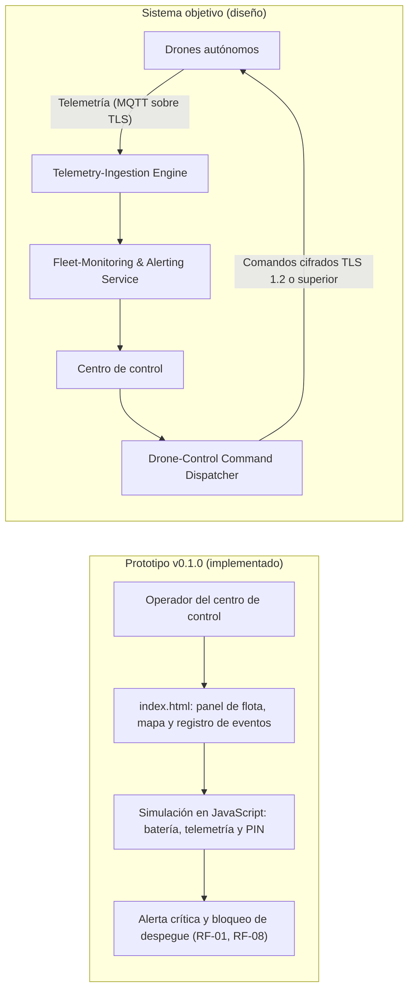

# Arquitectura de CyberLogistics X-2026

Diagrama de componentes del prototipo v0.1.0 (implementado) y del sistema objetivo (diseño).

## Componentes

| Componente | Estado | Requisito |
|---|---|---|
| Panel de flota y mapa | Implementado | RF-01, RF-04 |
| Registro de eventos de telemetría | Implementado (simulado) | RF-02 |
| PIN dinámico de entrega | Implementado (simulado) | RF-03, RF-06 |
| Bloqueo de despegue | Implementado | RF-08 |
| Telemetry-Ingestion Engine | Diseño | RNF-01 |
| Drone-Control Command Dispatcher | Diseño | RNF-02 |
| Fleet-Monitoring & Alerting Service | Diseño | RNF-04 |
